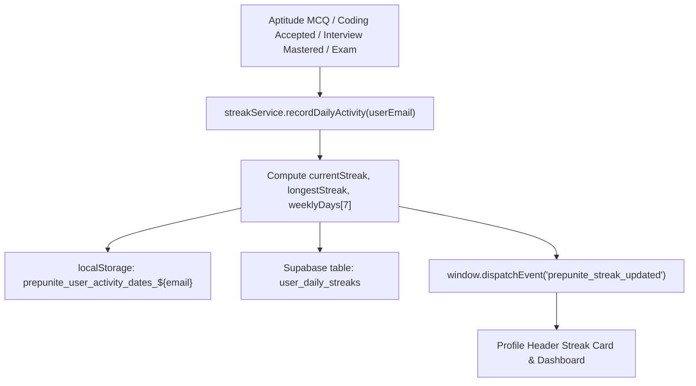

# 🚀 MockFolder / PrepUnite: Master Product, Scaling & Operations Roadmap (`docs/future.md`)

This is the **single source of truth** tracking operational checklists, upcoming features, content backlog, and production infrastructure scaling. *(Consolidated from root `future.md` and `docs/future.md`.)*

---

## 📋 Master Priority Matrix

| Priority | Item | Codebase Status | Trigger / Effort |
| :---: | :--- | :--- | :--- |
| **P0** | **Google Cloud OAuth Consent Screen Branding (Free)** | External console config | < 10 mins in Google Cloud Console (`MockFolder` / `PrepUnite`) |
| **P0** | **Razorpay Live Webhook Connection** | Code live (`api/webhook.js`) | < 10 mins in Razorpay Dashboard + Vercel Env Vars |
| **P1** | **Campus Technical & Cognitive Aptitude Track** | Frontend hidden in `Sidebar.tsx`; 0 DB rows | Seed 20–50 questions/topic in `topic_questions` & uncomment |
| **P1** | **Aptitude & Technical MCQ Paper Audit** | Coding 621 Qs audited; MCQs pending | Audit options/explanations before promoting papers |
| **P2** | **Universal Daily Practice Streak Engine** | Spec complete; not yet coded | Retention loop once daily active signups grow |
| **P2** | **Shareable Exam Achievement Cards** | Spec complete; not yet coded | Viral LinkedIn/WhatsApp growth once mock exam volume grows |
| **P2** | **Coding Workspace IDE Polish (History Drawer & Timer)** | Draft/latest restore exists; UI backlog | Next student IDE polish sprint |
| **P2** | **Programming 150 Cross-Linking** | `companyTags` exist; 2-way paper links pending | Placement prep navigation polish |
| **P3** | **TPO Bulk CSV / Proctoring Polish** | Tab-switch proctoring & Tier 1–3 analytics live | Before onboarding first institutional college drive |
| **P3** | **Supabase Pro (\$25/mo) + Custom Auth Domain (+\$10/mo)** | Currently on Free Tier | When onboarding first paying college or risk of 7-day DB pause |
| **P3** | **Dedicated Judge0 VPS (~\$15–\$40/mo) + Compiler SSL** | 3-tier fallback + `Promise.allSettled` live | When >50–100 students code simultaneously during drives |
| **P3** | **Vercel Pro (\$20/mo), Leaderboards, PWA Push, Ads** | `AdSpaceSlot.tsx` placeholder only | >5k–50k monthly traffic or active college batches |
| **Archived** | **EU AI Act / ISO 42001 AI Governance** | Blueprint only (no live LLM inference yet) | Revisit only if live LLM hint/generation APIs are shipped |

---

## 🔴 P0 — Immediate Operations Setup

### 1. Google OAuth Consent Screen Branding (Free) & White-Labeling Roadmap

#### Symptom & Root Cause
* **Symptom**: When candidates click "Sign in with Google", Google's account picker displays:
  ```text
  Choose an account to continue to tufajuhxjfbrbxsfzbpx.supabase.co
  ```
  instead of your brand name.
* **Root Cause**:
  1. Google OAuth displays the **App Name** from the Google Cloud Console OAuth Consent Screen. When unconfigured or left in testing, Google falls back to the raw OAuth redirect URI origin (`tufajuhxjfbrbxsfzbpx.supabase.co`).
  2. Supabase's default shared OAuth callback is `https://tufajuhxjfbrbxsfzbpx.supabase.co/auth/v1/callback`.

#### Free Immediate Fix: Google Cloud Console OAuth Consent Screen
This updates Google's consent screen header and logo with **$0 cost**:

1. Open **[Google Cloud Console](https://console.cloud.google.com/)** $\to$ select your OAuth project.
2. Go to **APIs & Services** $\to$ **OAuth consent screen** (or **Google Auth Platform &rarr; Branding**).
3. Fill in the verified production details:
   * **App name**: `MockFolder` *(or `PrepUnite`)*
   * **User support email**: `mockfolder@gmail.com` *(or `prepsunite@gmail.com`)*
   * **App logo**: Upload [`frontend/public/favicon-192.png`](file:///d:/Side%20projects/Prepunite/frontend/public/favicon-192.png) (`192×192`, `30 KB`) or [`frontend/public/mockfolder-logo.png`](file:///d:/Side%20projects/Prepunite/frontend/public/mockfolder-logo.png) (`930×930`, `469 KB`).
   * **Application home page**: `https://jobsfolder.vercel.app`
   * **Application privacy policy link**: `https://jobsfolder.vercel.app/privacy-policy`
   * **Application terms of service link**: `https://jobsfolder.vercel.app/terms-and-conditions`
   * **Authorized domains**: `vercel.app`, `supabase.co` *(plus your custom domain when attached)*
   * **Developer contact information**: `mockfolder@gmail.com`
4. Under **Audience / Publishing Status**: click **Publish App** so it moves from **Testing** to **In Production**.
   * *Note*: Standard scopes (`openid`, `.../auth/userinfo.email`, `.../auth/userinfo.profile`) are non-sensitive and do not require Google verification review.

#### Paid White-Label Upgrade (P3 — Only When On Supabase Pro): Custom Auth Domain
To replace `tufajuhxjfbrbxsfzbpx.supabase.co` in the URL bar completely (requires **Supabase Pro \$25/mo + Custom Domain Add-on \$10/mo**):
1. In **Supabase Dashboard &rarr; Project Settings &rarr; Custom Domains**, add your custom subdomain (e.g., `auth.prepunite.com`).
2. Add DNS records in Cloudflare / DNS provider:
   * **CNAME**: `auth` $\to$ `tufajuhxjfbrbxsfzbpx.supabase.co` (DNS Only if using Cloudflare).
   * **TXT**: Verification record provided by Supabase for SSL issuance.
3. Click **Verify Domain** in Supabase until SSL shows Active/Green.
4. In **Google Cloud Console &rarr; Credentials &rarr; OAuth 2.0 Client IDs**, add `https://auth.prepunite.com/auth/v1/callback` under **Authorized redirect URIs** *(keep the `.supabase.co` callback temporarily during DNS propagation)*.
5. Set `VITE_SUPABASE_URL=https://auth.prepunite.com` in `frontend/.env` and Vercel Environment Variables, then redeploy.

```text
Candidate Browser               Google Accounts OAuth             Supabase Auth Engine
┌─────────────────┐             ┌─────────────────────┐          ┌───────────────────────────┐
│ Click "Sign In  │ ──────────> │ "Continue to        │          │ Validates Identity &      │
│ with Google"    │             │  MockFolder"        │          │ Issues Supabase Session   │
└─────────────────┘             └─────────────────────┘          └───────────────────────────┘
         ▲                                 │                                    │
         │                                 ▼                                    │
         │                      [User Grants Consent]                           │
         │                                 │                                    ▼
┌─────────────────┐             ┌─────────────────────┐          ┌───────────────────────────┐
│ Redirect back   │ <────────── │ Callback:           │ <─────── │ Auth Token & Cookie Set   │
│ (/jobs or dash) │             │ auth.prepunite.com  │          │ (JWT + Refresh Token)     │
└─────────────────┘             └─────────────────────┘          └───────────────────────────┘
```

---

### 2. Razorpay Payment Gateway: Production Security & Webhook Setup

#### Status & Endpoints
* **Status**: 🟢 **Code Live in Production** (`rzp_live_...` active across Vercel & Supabase).
* **Endpoints**:
  * [`api/create-order.js`](file:///d:/Side%20projects/Prepunite/api/create-order.js): Server-side order creation and pre-order ledger lock.
  * [`api/verify-payment.js`](file:///d:/Side%20projects/Prepunite/api/verify-payment.js): Instant client-triggered HMAC-SHA256 signature verification & entitlement fulfillment.
  * [`api/webhook.js`](file:///d:/Side%20projects/Prepunite/api/webhook.js): Asynchronous background capture, deduplication, and refund/chargeback revocation *(prefers verified `payment.notes.userEmail` over Razorpay billing email so UPI checkout email differences never cause ownership mismatches)*.

#### Test Mode vs. Live Mode
* **Test Mode (`rzp_test_...`)**: Shows the Razorpay Sandbox prompt ("Success" / "Failure") so engineers can test both outcomes without real cards.
* **Live Mode (`rzp_live_...`)**: That popup cannot appear. Users are routed to real bank 3D-Secure OTP or UPI PIN flows (PhonePe, Google Pay, Paytm, CRED) before Razorpay issues a cryptographic signature.

#### The 6-Layer Security Shield

```text
Candidate Browser              Vercel Serverless                   Supabase PostgreSQL
┌─────────────────┐           ┌───────────────────┐               ┌────────────────────┐
│ 1. Click Plan   │ ────────> │ 2. Enforce Price  │ ────────────> │ 3. Create Pre-Order│
│                 │           │    (Catalog only) │               │    Ledger Row      │
└─────────────────┘           └───────────────────┘               └────────────────────┘
         ▲                              │
         └────── 4. Bank OTP / UPI ─────┘
         │
         │                    ┌───────────────────┐               ┌────────────────────┐
         └─ 5. Signature ───> │ 6. HMAC-SHA256    │ ────────────> │ 7. fulfill_payment │
                              │    Verify Secret  │               │    _order RPC      │
                              └───────────────────┘               └────────────────────┘
```

| Shield Layer | Threat Mitigated | Defense Mechanism | Location |
|---|---|---|---|
| **1. Zero-Trust Pricing** | Tampering client JS to pay `₹1` | Server ignores client `amount`; resolves strictly from `PRICING_CATALOG` (`PRO=129`, `ULTRA=169`, `SINGLE=59`). | [`api/create-order.js`](file:///d:/Side%20projects/Prepunite/api/create-order.js) |
| **2. Cryptographic Signature** | Forged `payment_id` payload | Server verifies `HMAC-SHA256(order_id \| payment_id, RAZORPAY_KEY_SECRET)` via `crypto.timingSafeEqual`. | [`api/verify-payment.js`](file:///d:/Side%20projects/Prepunite/api/verify-payment.js) |
| **3. Anti-Plan Substitution** | Paying ₹59, claiming ₹1,799 Ultra | `fulfill_payment_order` RPC locks `payment_orders` by `order_id` and grants entitlements from server-recorded `item_type`. | [`TARGET_D_PAYMENT_GATEWAY_AND_ENTITLEMENTS.sql`](file:///d:/Side%20projects/Prepunite/database/migrations/TARGET_D_PAYMENT_GATEWAY_AND_ENTITLEMENTS.sql) |
| **4. Identity & Anti-Replay** | Replaying another user's payment ID | Verifies Supabase JWT email matches `payment_orders.user_email`; `payment_id` has a `UNIQUE` constraint. | [`api/verify-payment.js`](file:///d:/Side%20projects/Prepunite/api/verify-payment.js) |
| **5. Database RLS Guardrails** | Client DevTools `isUnlocked = true` | Paid paper nodes in `public.paper_tab_nodes` enforce PostgreSQL RLS (0 rows returned without entitlement). | [`TARGET_H_COMPANY_PAPERS_AND_DRM_HARDENING.sql`](file:///d:/Side%20projects/Prepunite/database/migrations/TARGET_H_COMPANY_PAPERS_AND_DRM_HARDENING.sql) |
| **6. Atomic Quotas** | Spamming mock exam generator | `consume_mock_exam_quota` RPC enforces atomic quota decrement before exam synthesis. | `mockExamSubscription.service.ts` |

#### Dual-Redundancy Webhook Dashboard Setup (10 Mins)
Connecting webhooks guarantees **students who pay via mobile UPI and close the tab before redirecting still get unlocked automatically**:
1. Log into **[Razorpay Dashboard](https://dashboard.razorpay.com/)** $\to$ **Account & Settings** $\to$ **Webhooks**.
2. Click **Add New Webhook**:
   * **Webhook URL**: `https://jobsfolder.vercel.app/api/webhook`
   * **Secret**: Generate a strong 32+ character random string (no spaces/newlines).
   * **Active Events**:
     * `payment.captured`
     * `refund.processed`
     * `payment.dispute.created`
3. Open **Vercel Dashboard &rarr; Project Settings &rarr; Environment Variables** and add:
   * **Name**: `RAZORPAY_WEBHOOK_SECRET`
   * **Value**: Exact same secret string
   * **Environments**: Production (and Preview if testing)
4. Trigger a **Redeploy** in Vercel so serverless functions pick up the new env var.

#### Database Ledger Reference
| Table Name | Role |
|---|---|
| `public.payment_orders` | Pre-order ledger storing locked `order_id`, `item_type`, `amount_inr`, and `user_email`. |
| `public.transactions` | Immutable transaction audit log with `UNIQUE(payment_id)`. |
| `public.user_subscriptions` | Pro / Ultra passes with atomic expiration extensions. |
| `public.user_paper_purchases` | 30-day single company paper passes mapped by `(user_email, exam_id)`. |
| `public.webhook_events` | Idempotency log (`event_id`) preventing duplicate webhook execution. |
| `public.user_mock_exam_quotas` | Monthly mock exam usage counter per user (`YYYY-MM`). |

---

## 🟠 P1 — Content & Conversion Wins

### 3. Campus Technical & Cognitive Aptitude Track (`technical-aptitude`)

#### Summary & Status
* **Status**: 🟡 **TEMPORARILY HIDDEN** from UI navigation (all frontend routing preserved).
* **Reason**: All 6 topics currently show `0 Questions` on `/aptitude/technical-aptitude/topic/*` because database seeding has not run yet.
* **Distinct Purpose**: Unlike the **Technical Hub** (`/technical?track=mcqs`, which hosts IndiaBIX Core CS MCQs), this track models **Company Campus OAs** (Accenture, Capgemini, AMCAT, CoCubes, Cognizant).

#### Relevant Files
| Layer | File Path | Notes |
|---|---|---|
| **Sidebar Navigation** | [`frontend/src/components/Sidebar.tsx`](file:///d:/Side%20projects/Prepunite/frontend/src/components/Sidebar.tsx#L212) | `Technical Aptitude` commented out in `aptitudeCategories`. |
| **Aptitude Controller** | [`frontend/src/pages/AptitudePage.tsx`](file:///d:/Side%20projects/Prepunite/frontend/src/pages/AptitudePage.tsx) | `categoryTitles['technical-aptitude']` header & routing. |
| **Blueprint Registry** | `frontend/src/services/mockExamBlueprint.service.ts` | Built-in category topics definition. |
| **Slug Resolver** | `frontend/src/services/topicMap.ts` | Natural text $\to$ canonical topic slug mapper. |
| **Database Target** | Supabase table `topic_questions` | Target table for seeding MCQs. |

#### The 6 Topics
| Topic Slug | Topic Name | Company Pattern | Concepts Tested |
|---|---|---|---|
| `attention-to-detail` | **Attention to Detail & Visual Checking** | Accenture Cognitive, CoCubes | Rapid alphanumeric string comparisons, serial matching, symbol errors under 20–30s time pressure. |
| `bitwise-operators` | **Bitwise Operators & Logic** | Accenture, Capgemini | Dry-running XOR (`^`), AND (`&`), OR (`\|`), bit shifts (`<<`, `>>`), bit masks, power-of-two tricks. |
| `recursion-functions` | **Recursion & Function Scope** | Accenture, Capgemini, TCS Prime | Tracing recursion call trees, return accumulation, static vs global variables across frames. |
| `code-debugging-logic` | **Code Debugging & Automata Fix** | AMCAT Automata Fix, Cognizant GenC | 5–15 line code snippets with 1 syntax/logical bug (off-by-one boundary, wrong operator, missing return). |
| `pseudocode-tracing` | **Pseudocode & Variable Tracing** | Accenture, Capgemini | Multi-variable dry runs (`p, q, r`), nested `for`/`while` loops, modulo arithmetic, branches. |
| `cloud-networking-basics` | **General Tech, OS & Cloud Basics** | TCS NQT, Accenture Cloud | IaaS/PaaS/SaaS, AWS/Azure basics, Git, virtualization, HTTP/DNS/REST. |

#### Restoration Checklist
1. Seed 20–50 MCQs per topic in Supabase `topic_questions` (`category_slug = 'technical-aptitude'`, valid `topic_id`, `difficulty`, `question`, `options`, `correct_answer`, `explanation`).
2. Uncomment `{ name: 'Technical Aptitude', slug: 'technical-aptitude', icon: Terminal },` in [`frontend/src/components/Sidebar.tsx`](file:///d:/Side%20projects/Prepunite/frontend/src/components/Sidebar.tsx#L212).
3. Run `npm --prefix frontend run build` and verify `/aptitude/technical-aptitude` shows non-zero question counts.

---

### 4. Aptitude & Technical MCQ Placement Paper Audit
* **Current State**: Completed automated audit across all 621 Coding paper questions (0 duplicate test cases, $\ge 4$ distinct test cases per problem).
* **Remaining Audit**: Programmatic check across Quantitative Aptitude, Logical Reasoning, and Technical MCQ paper tabs for clean option keys (`A`–`D`), zero raw unescaped HTML entities, and non-empty explanations.

---

## 🟡 P2 — Retention, Growth & IDE Polish

### 5. Universal Daily Practice Streak & Dopamine Hub
* **Status**: 📋 **SPECIFIED** (not yet coded; `streak.service.ts` does not exist yet).
* **Target Location**: `/profile` ([`ProfilePage.tsx`](file:///d:/Side%20projects/Prepunite/frontend/src/pages/ProfilePage.tsx)) hero header card + dashboard sync.
* **4 Core Rules**:
  1. **Universal Trigger**: Aptitude MCQ solved (`progressService`), Coding accepted (`technicalService`), Interview question mastered (`interviewService`), or Mock Exam submitted (`MockExamTestPage.tsx`) all extend the streak.
  2. **Instant Dopamine Feedback**: First completion of the day ignites the flame badge + shows toast (*"🔥 Streak Extended to X Days!"*).
  3. **7-Day Micro Calendar (`M T W T F S S`)**: Orange glow on completed days, ring on today, muted upcoming days.
  4. **Local Timezone Grace Window**: Uses local `YYYY-MM-DD`; practicing yesterday keeps streak alive today until midnight local time.



```typescript
export interface DailyStreakState {
  currentStreak: number;
  longestStreak: number;
  isPracticedToday: boolean;
  lastActiveDate: string | null; // YYYY-MM-DD
  totalActiveDays: number;
  weeklyDays: {
    dayName: 'M' | 'T' | 'W' | 'T' | 'F' | 'S' | 'S';
    dateStr: string; // YYYY-MM-DD
    isCompleted: boolean;
    isToday: boolean;
    isFuture: boolean;
  }[];
}
```
* **Checklist**: Build `frontend/src/services/streak.service.ts`, wire the 4 triggers, create `user_daily_streaks` Supabase table with RLS, and mount UI in `ProfilePage.tsx`.

---

### 6. Viral Shareable Exam Achievement Cards (`ShareScoreModal.tsx`)
* **Status**: Not built (`ShareModal.tsx` and `ShareMockExamModal.tsx` currently handle link sharing, not PNG scorecard generation).
* **Purpose**: Export high-res PNG scorecards (Score %, Rank, Target Company badge) using `html-to-image` for 1-click LinkedIn / WhatsApp Status sharing after finishing a mock exam.

---

### 7. Coding Workspace IDE Polish (`TechnicalCodingWorkspacePage.tsx`)
* **Already Built**: Latest submission restore + sample I/O + Hints accordion in [`HackerRankProblemView.tsx`](file:///d:/Side%20projects/Prepunite/frontend/src/components/HackerRankProblemView.tsx#L304).
* **Backlog Polish**:
  1. **Multi-Attempt Submissions History Drawer**: Tab inside the bottom execution console listing chronological past runs (`Accepted` / `WA` / `TLE`, runtime, memory) with 1-click **Load Code**.
  2. **Practice Stopwatch / Countdown Timer**: Toggleable 20m / 30m / 45m OA countdown timer in the top toolbar with local persistence.
  3. **Hints & Optimal Complexity Accordion** inside [`TechnicalCodingWorkspacePage.tsx`](file:///d:/Side%20projects/Prepunite/frontend/src/pages/TechnicalCodingWorkspacePage.tsx) matching `HackerRankProblemView`.

---

### 8. Programming 150 Core Sheet Cross-Linking
* **Already Built**: Company tag metadata and filtering on [`TechnicalHubPage.tsx`](file:///d:/Side%20projects/Prepunite/frontend/src/pages/TechnicalHubPage.tsx#L443).
* **Remaining**: Direct bidirectional links between Company Old Paper coding problems and their matching canonical guide in Programming 150.

---

## ⚪ P3 — Trigger-Based Infrastructure & Institutional Scale

### 9. Compiler Engine Scaling Roadmap (`api/execute-code.js`)
* **Tier 0 (Active Free Plan — <500 concurrent)**: Already tuned with parallel `Promise.allSettled`, 3s cooldown, `localStorage` draft caching, and 3-tier fallback (`JUDGE0_URL` $\to$ RapidAPI $\to$ `https://ce.judge0.com`).
* **Tier 1 (Trigger: >50–100 simultaneous coders / First College — ~\$15–\$40/mo)**: Dedicated Judge0 Docker host (e.g., Hetzner CPX31 4 vCPU / 8GB RAM or AWS Mumbai) + Caddy Auto-SSL (`compiler.prepunite.com`) + `JUDGE0_URL` / `JUDGE0_API_KEY` env vars (0 code changes required).
* **Tier 2–3 (Trigger: 2,000–20,000 Pan-India Drives — \$120–\$300/mo)**: Load-balanced Judge0 nodes + async Upstash QStash queue + Supabase Realtime execution push.

### 10. Supabase Pro (\$25/mo) & Vercel Pro (\$20/mo)
* **Supabase Pro Trigger**: First paying college onboarded or approaching 7-day inactivity pause / 200+ concurrent pooled connections. Unlocks zero sleeping, 1,000+ pooled connections, daily backups, and optional \$10/mo Custom Auth Domain.
* **Vercel Pro Trigger**: Exceeding 100GB/mo hobby bandwidth or needing longer serverless timeouts.

### 11. Campus Leaderboards, Mobile PWA Push & Ad Monetization
* **Campus & Batch Leaderboard Engine**: SQL materialized view `college_leaderboard_view` partitioned by `college_id`, `graduation_year`, and `branch`. *(Wait until college cohorts have 50+ active exam takers.)*
* **Mobile PWA Web Push (`public/sw.js` + `push_subscriptions` table)**: Background alerts, lock screen notifications, and app icon badges. *(Revisit once repeat daily active student base exceeds 1,000+.)*
* **Publisher Ad Monetization (`AdSpaceSlot.tsx`)**: Carbon Ads / EthicalAds / NitroPay / EdTech affiliates once organic traffic reaches >5,000–50,000 monthly views (avoid cluttering coding/exam views before then).

### 12. TPO Institutional Portal Polish
* **Already Live**: Tab-switch malpractice tracking in [`MockExamTestPage.tsx`](file:///d:/Side%20projects/Prepunite/frontend/src/pages/MockExamTestPage.tsx#L512-L548) and Tier 1/2/3 readiness clustering in [`TpoAnalyticsPage.tsx`](file:///d:/Side%20projects/Prepunite/frontend/src/pages/tpo/TpoAnalyticsPage.tsx#L219-L412).
* **Remaining Before Live Drive**: Final QA on bulk CSV validation edge cases and scheduled hard drive auto-termination cutoffs.

---

## 📦 Archived / Deferred (Skip Unless Requirements Change)

### AI Governance & Security Architecture (`EU AI Act`, `NIST AI RMF`, `ISO 42001`)
* **Why Deferred**: Current backend (`api/*.js`) and frontend services have **zero live LLM/vector inference calls** (Code execution runs in Judge0/client workers; questions/interviews are curated DB/seed records). Implementing `ai_telemetry_logs`, prompt-injection middleware (`aiGuardrails.ts`), and `scripts/evaluate_ai_quality.mjs` is unnecessary overhead unless/until live LLM features (e.g., AI hint generation or RAG search) are shipped in production.

*Reference snippet preserved for future LLM launches: `ai_telemetry_logs` (`id`, `user_id`, `feature_name`, `model_name`, `prompt_hash`, `prompt_tokens`, `completion_tokens`, `latency_ms`, `status`, `created_at`) + `applyInputGuardrails()` PII/injection sanitizer + `evaluateQuestionSchema()` CI script.*
