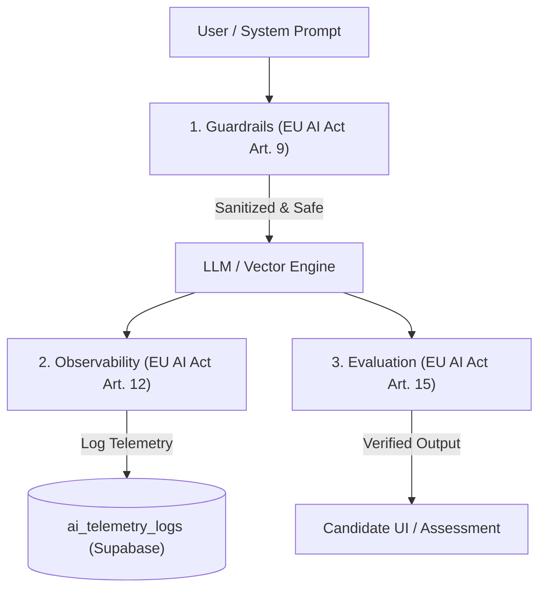

# 🚀 PrepUnite: Future Features & Backlog Roadmap (`future.md`)

This file tracks paused, hidden, or upcoming features and content modules so you can easily recall what was done, where the code lives, and the exact steps to restore or complete it.

---

## 📌 Active Backlog Item: Campus Technical & Cognitive Aptitude Track

### 1. Summary & Status
* **Status**: 🟡 **TEMPORARILY HIDDEN** from UI navigation (code preserved 100%).
* **Reason**: All 6 topics currently show `0 Questions` on `/aptitude/technical-aptitude/topic/*` because questions have not yet been seeded in the database.
* **Distinct Purpose**: Unlike the **Technical Hub** (`/technical?track=mcqs`, which contains 500 core CS MCQs like C, C++, Java, DBMS, OS, CN), this category is specifically modeled for **Company Campus Online Assessments (OAs)** like **Accenture, Capgemini, AMCAT, CoCubes, and Cognizant**.

---

### 2. Relevant File Directories

| Component / Layer | File Path | What It Handles |
|---|---|---|
| **Sidebar Navigation (Aptitude)** | `frontend/src/components/Sidebar.tsx` | Line ~125: `aptitudeCategories` array (`Technical Aptitude` commented out). |
| **Aptitude Controller** | `frontend/src/pages/AptitudePage.tsx` | Line ~467: `categoryTitles['technical-aptitude']` defines the title and header banner. |
| **Technical Hub Controller** | `frontend/src/pages/TechnicalHubPage.tsx` | Controller for `/technical?track=mcqs` rendering the 10 IndiaBIX subjects (Active). |
| **Blueprint Registry** | `frontend/src/services/mockExamBlueprint.service.ts` | Lines ~678–686: Built-in category topics definition. |
| **Slug Resolver** | `frontend/src/services/topicMap.ts` | Lines ~268–289: Maps natural text names to canonical topic slugs. |
| **Database Target** | Supabase table: `topic_questions` | Storage table where questions for these topics need to be inserted. |

---

### 3. The 6 Topics & What They Test

| Topic Slug | Topic Name | Company Exam Pattern | Question Format / Concepts |
|---|---|---|---|
| `attention-to-detail` | **Attention to Detail & Visual Checking** | **Accenture Cognitive**, **CoCubes** | Rapid alphanumeric string comparisons, address/serial number matching, symbol substitution errors under 20–30s time pressure. *(Non-coding cognitive test)* |
| `bitwise-operators` | **Bitwise Operators & Logic** | **Accenture**, **Capgemini** | Dry-running bitwise XOR (`^`), AND (`&`), OR (`\|`), bit shifts (`<<`, `>>`), half-adder logic, bit masks, and power-of-two tricks. |
| `recursion-functions` | **Recursion & Function Scope** | **Accenture**, **Capgemini**, **TCS Prime** | Tracing recursion call trees, return value accumulation, static vs global variable retention across recursive frames. |
| `code-debugging-logic` | **Code Debugging & Automata Fix** | **AMCAT Automata Fix**, **Cognizant GenC** | 5–15 line code snippets with exactly 1 syntax or logical bug (e.g., off-by-one loop boundary, incorrect operator, missing return). |
| `pseudocode-tracing` | **Pseudocode & Variable Tracing** | **Accenture**, **Capgemini** | Multi-variable dry runs (`p = 1, q = 2, r = 3`), nested `for` / `while` loop iterations, modulo arithmetic, condition branches. |
| `cloud-networking-basics` | **General Tech, OS & Cloud Basics** | **TCS NQT**, **Accenture Cloud** | Cloud models (IaaS / PaaS / SaaS), AWS/Azure basics, Git & version control, virtualization, web protocols (HTTP/DNS/REST). |

---

### 4. Step-by-Step Restoration Checklist (When Ready)

When you are ready to launch this module:

1. **Seed Questions in Database**:
   Insert 20 to 50 MCQs per topic into the Supabase `topic_questions` table with:
   * `category_slug`: `'technical-aptitude'`
   * `topic_id`: one of `attention-to-detail`, `bitwise-operators`, `recursion-functions`, `code-debugging-logic`, `pseudocode-tracing`, `cloud-networking-basics`
   * `difficulty`: `'Easy'`, `'Medium'`, or `'Hard'`
   * `question`, `options` (JSON array or object), `correct_answer`, `explanation`

2. **Unhide in Sidebar**:
   Open `frontend/src/components/Sidebar.tsx`:
   - Under `aptitudeCategories` (around line 125), uncomment:
     ```tsx
     { name: 'Technical Aptitude', slug: 'technical-aptitude', icon: Terminal },
     ```

3. **Verify Build & Routes**:
   Run:
   ```bash
   npm --prefix frontend run build
   ```
   Navigate to `/aptitude/technical-aptitude` to verify all topic cards show live question counts instead of 0.

---

## 🛡️ Razorpay Payment Gateway: Production Security Architecture & Anti-Bypass Guardrails

### 1. Summary & Status
* **Status**: 🟢 **LIVE IN PRODUCTION** (`rzp_live_...` active across Vercel & Supabase).
* **Core Protection**: Strict zero-trust server validation. No candidate can bypass the paywall, forge a payment, tamper with prices, or substitute a cheap plan for an expensive one.
* **Relevant Endpoints**:
  * `/api/create-order.js`: Server-side order creation and pre-order ledger lock.
  * `/api/verify-payment.js`: Instant client-triggered HMAC-SHA256 signature verification & entitlement fulfillment.
  * `/api/webhook.js`: Asynchronous background capture, deduplication, and refund/chargeback revocation.

---

### 2. Frequently Asked Question: Test Mode vs. Live Mode
**Q: During testing, I was asked to choose whether payment was "Success" or "Failure". Can real users do this to get free access?**
* **Answer**: **No. That dialog is mathematically impossible for real users to see.**
* **Why it appeared**: That popup was the **Razorpay Developer Sandbox Simulator**, which only exists when using test credentials (`rzp_test_...`) to allow engineers to test both success and failure flows without real cards.
* **In Live Mode (`rzp_live_...`)**: Razorpay directs the candidate directly to their **real bank OTP page or UPI app (PhonePe, Google Pay, Paytm, CRED)**. Real money must be deducted, and the bank must cryptographically sign off on the capture before Razorpay issues a signature.

---

### 3. The 6-Layer Security Shield Protecting Jobsfolder

```
Candidate Browser              Vercel Serverless                   Supabase PostgreSQL
┌─────────────────┐           ┌───────────────────┐               ┌────────────────────┐
│ 1. Click Plan   │ ────────> │ 2. Enforce Price  │ ────────────> │ 3. Create Pre-Order│
│                 │           │    (Catalog only) │               │    Ledger Row      │
│                 │           └───────────────────┘               └────────────────────┘
│                 │                     │
│ 4. Bank OTP     │ <───────────────────┘
│    via Razorpay │
│                 │           ┌───────────────────┐               ┌────────────────────┐
│ 5. Send Payment │ ────────> │ 6. HMAC-SHA256    │ ────────────> │ 7. fulfill_payment │
│    Signature    │           │    Verify Secret  │               │    _order RPC      │
└─────────────────┘           └───────────────────┘               └────────────────────┘
                                                                            │
                                                                  [Database grants access
                                                                   strictly from Ledger]
```

| Shield Layer | Potential Threat | Engineering Defense Mechanism | File / Location |
|---|---|---|---|
| **1. Zero-Trust Pricing** | Hacker edits client JS to request `amount: ₹1` instead of `₹129`. | Server **completely ignores client `amount`**. It resolves the price strictly from the server-side `PRICING_CATALOG` (`PRO=129`, `ULTRA=169`, `SINGLE=59`). Razorpay only opens an order for the exact server price. | `api/create-order.js` |
| **2. Cryptographic Signature** | Hacker sends a fake `razorpay_payment_id: "pay_fake123"` to the API. | Server computes `HMAC-SHA256(order_id \| payment_id, RAZORPAY_KEY_SECRET)` using `crypto.timingSafeEqual`. Without the live secret key, a fake signature cannot be generated. | `api/verify-payment.js` |
| **3. Anti-Plan Substitution** | Hacker pays ₹59 for a single paper, then calls verify claiming they bought the ₹1,799 1-Year Ultra plan. | The `fulfill_payment_order` PostgreSQL RPC locks the order in `public.payment_orders` by `order_id` and grants entitlements **strictly based on the `item_type` recorded at order creation time**. Client payload claims are discarded. | `database/migrations/TARGET_D_PAYMENT_GATEWAY_AND_ENTITLEMENTS.sql` |
| **4. Identity & Anti-Replay** | User B intercepts User A's `payment_id` and tries to claim it on User B's account. | 1. API verifies user email via Supabase JWT session.<br>2. Verifies that JWT email matches `payment_orders.user_email` (`403 Forbidden` if mismatch).<br>3. `payment_id` has a `UNIQUE` database constraint (`ON CONFLICT`). A payment can never be redeemed twice. | `api/verify-payment.js` & `public.transactions` |
| **5. Database Row-Level Security** | Hacker alters React state in Chrome DevTools to set `isUnlocked = true`. | Paid question content is stored in `public.paper_tab_nodes`. PostgreSQL enforces RLS: unentitled users receive **0 rows from the database** even if they send direct API requests. | `database/migrations/TARGET_H_COMPANY_PAPERS_AND_DRM_HARDENING.sql` |
| **6. Atomic Quotas & Concurrency** | Candidate spams mock exam generator in an automated loop. | Generation calls the `consume_mock_exam_quota` RPC inside Supabase. If quota is exhausted or plan is free, the transaction aborts before questions are ever generated. | `frontend/src/services/mockExamSubscription.service.ts` |

---

### 4. Dual-Redundancy Webhook Setup (Recommended Next Step)

While browser-based verification (`/api/verify-payment`) works in real-time, configuring webhooks guarantees that **candidates who pay on mobile and accidentally close the browser tab before redirecting still get unlocked instantly**:

1. Log into **[Razorpay Dashboard](https://dashboard.razorpay.com/)**.
2. Navigate to **Settings &rarr; Webhooks**.
3. Click **Add New Webhook**:
   * **Webhook URL**: `https://jobsfolder.vercel.app/api/webhook`
   * **Secret**: Generate a strong secret (e.g. 32-character random string).
   * **Active Events**: Check:
     * `payment.captured`
     * `refund.processed`
     * `payment.dispute.created`
4. Copy the secret, open **Vercel Project Settings &rarr; Environment Variables**, and add:
   * **Variable Name**: `RAZORPAY_WEBHOOK_SECRET`
   * **Value**: Your chosen secret
   * **Environments**: Production, Preview, Development
5. Redeploy or save. The webhook handler in `/api/webhook.js` will automatically handle deduplication, background unlocks, and automated refund/dispute revocations.

---

### 5. Architectural Ledger & Database Schema Reference

| Table Name | Primary Role in Payment Security |
|---|---|
| `public.payment_orders` | Pre-order ledger. Stores authoritative `order_id`, `item_type`, `amount_inr`, and `user_email` locked before payment starts. |
| `public.transactions` | Immutable audit trail of every captured transaction with `payment_id` unique constraint. |
| `public.user_subscriptions` | Active subscription passes (Pro 5 Mock Exams/mo, Ultra Unlimited) with atomic expiration extensions. |
| `public.user_paper_purchases` | 30-day single company paper passes mapped by `(user_email, exam_id)`. |
| `public.webhook_events` | Idempotency log storing `event_id` to prevent duplicate webhook processing. |
| `public.user_mock_exam_quotas` | Monthly counter tracking mock exam generation usage per candidate (`YYYY-MM`). |

---

## 🔐 Google OAuth & Supabase Auth White-Labeling (`Choose an account to continue to...`)

### 1. Symptom & Root Cause
* **Symptom**: When candidates click "Sign in with Google", Google's account picker displays:
  ```
  Choose an account to continue to tufajuhxjfbrbxsfzbpx.supabase.co
  ```
  instead of **"to continue to PrepUnite"**.
* **Root Cause**:
  1. Google OAuth displays the **App Name** from the Google Cloud Console OAuth Consent Screen. If unconfigured or in testing mode without branding, Google defaults to displaying the raw OAuth redirect URI origin domain (`tufajuhxjfbrbxsfzbpx.supabase.co`).
  2. The OAuth redirect callback URL is currently hosted on Supabase's default shared domain (`https://<project-ref>.supabase.co/auth/v1/callback`), so Google displays the Supabase domain as the authorized destination.

---

### 2. Immediate Fix: Configure Google Cloud OAuth Consent Screen (Free)

This updates Google's header prompt to show your company name (e.g., **"Continue to PrepUnite"**):

1. **Open Google Cloud Console**:
   * Navigate to [Google Cloud Console](https://console.cloud.google.com/) $\to$ Select your project.
2. **Access OAuth Consent Screen**:
   * Go to **APIs & Services** $\to$ **OAuth consent screen** (or **Branding**).
3. **Configure App Branding**:
   * **App name**: `PrepUnite` (or your registered legal company name).
   * **User support email**: Select your verified administrator email (e.g., `prepsunite@gmail.com`).
   * **App logo**: Upload PrepUnite square logo (120x120px PNG/JPG).
   * **Application home page**: `https://prepunite.com`
   * **Application privacy policy link**: `https://prepunite.com/privacy`
   * **Application terms of service link**: `https://prepunite.com/terms`
   * **Authorized domains**: Add `prepunite.com` and `supabase.co`.
   * **Developer contact information**: `prepsunite@gmail.com`.
4. **Publishing Status**:
   * If status is **Testing**, click **Publish App** to move it to **In Production**.
   * *Note*: Standard scopes (`openid`, `.../auth/userinfo.email`, `.../auth/userinfo.profile`) are non-sensitive and do not trigger a full Google manual review or verification audit.

---

### 3. Production White-Label Upgrade: Supabase Custom Domain (`auth.prepunite.com`)

To completely eliminate `tufajuhxjfbrbxsfzbpx.supabase.co` from the browser address bar and Google redirect prompts:

* **Requirement**: Supabase Pro plan ($25/mo) + Custom Domain add-on ($10/mo).

#### Step-by-Step Migration:
1. **Configure in Supabase Dashboard**:
   * Navigate to **Project Settings** $\to$ **Custom Domains**.
   * Enter your desired subdomain: `auth.prepunite.com`.
2. **Add DNS Records (Cloudflare / DNS Provider)**:
   * **CNAME Record**: `auth` $\to$ `tufajuhxjfbrbxsfzbpx.supabase.co` (Proxy status: DNS Only if using Cloudflare).
   * **TXT Record**: Add the TXT verification record provided by Supabase for Let's Encrypt / Google Trust Services SSL generation.
3. **Activate Domain**:
   * In the Supabase Dashboard, click **Verify Domain**. Once SSL status turns Green/Active, all auth routes resolve through `https://auth.prepunite.com`.
4. **Update Google Cloud Console OAuth Credentials**:
   * Go to **APIs & Services** $\to$ **Credentials** $\to$ Select your Web OAuth 2.0 Client.
   * Under **Authorized redirect URIs**, add:
     ```
     https://auth.prepunite.com/auth/v1/callback
     ```
   * *(Keep the old `.supabase.co` callback temporarily during DNS propagation to avoid downtime)*.
5. **Update Codebase & Environment Variables**:
   * In `frontend/.env` and Vercel Project Settings:
     ```env
     VITE_SUPABASE_URL=https://auth.prepunite.com
     ```
   * Deploy the frontend. All auth flows will now show `auth.prepunite.com` end-to-end.

---

### 4. Architectural Auth Redirect Flow

```
Candidate Browser               Google Accounts OAuth             Supabase Auth Engine
┌─────────────────┐             ┌─────────────────────┐          ┌───────────────────────────┐
│ Click "Sign In  │ ──────────> │ "Continue to        │          │ Validates Identity &      │
│ with Google"    │             │  PrepUnite"         │          │ Issues Supabase Session   │
└─────────────────┘             └─────────────────────┘          └───────────────────────────┘
         ▲                                 │                                    │
         │                                 ▼                                    │
         │                      [User Grants Consent]                           │
         │                                 │                                    │
         │                                 ▼                                    ▼
┌─────────────────┐             ┌─────────────────────┐          ┌───────────────────────────┐
│ Redirect to     │ <────────── │ Callback:           │ <─────── │ Auth Token & Cookie Set   │
│ /dashboard      │             │ auth.prepunite.com  │          │ (JWT + Refresh Token)     │
└─────────────────┘             └─────────────────────┘          └───────────────────────────┘
```

---

## 🤖 AI Governance & Security Architecture (`EU AI Act`, `NIST AI RMF`, `ISO 42001`)

### 1. Context & Compliance Audit Status
* **Current AI Risk Score**: 82 / 100 (*"Good Posture"*).
* **Aggregate Controls**: 27 met · 0 failed (100% compliance across SOC 2, CISA AI, PCI DSS, OWASP LLM Top 10, MITRE ATLAS, GDPR).
* **AI Stack Detected**:
  * **Vector Database**: Supabase Vector (`pgvector`) for question semantic similarity & blueprint synthesis.
  * **LLM Provider**: Replicate / LLM inference APIs for automated question drafting, candidate hints, and explanation generators.
  * **Agent Tools**: Code Interpreter Sandbox (`api/execute-code.js`, `picoc-js`, `JSCPP`) executing student coding solutions.

---

### 2. The 3 Governance Findings & Resolution Blueprint

To elevate the AI Risk Score from **82 to 98+** and achieve formal audit compliance under the **EU AI Act** and **ISO 42001**, the following 3 medium-level governance modules must be activated:



---

### 3. Implementation Step 1: AI Observability & Audit Logging (Art. 12 · ISO 42001 A.8.2)

#### The Gap:
Article 12 of the EU AI Act mandates automated event-logging capabilities across the full lifecycle to ensure traceability, forensic auditability, and error tracking.

#### Technical Resolution:
1. **Create the Supabase Telemetry Table**:
   ```sql
   CREATE TABLE IF NOT EXISTS public.ai_telemetry_logs (
       id UUID PRIMARY KEY DEFAULT gen_random_uuid(),
       user_id UUID REFERENCES auth.users(id) ON DELETE SET NULL,
       session_id TEXT,
       feature_name TEXT NOT NULL,         -- e.g., 'hint_generator', 'blueprint_synthesizer', 'semantic_search'
       model_name TEXT NOT NULL,           -- e.g., 'meta/meta-llama-3-70b-instruct'
       provider TEXT NOT NULL DEFAULT 'replicate',
       prompt_hash TEXT NOT NULL,          -- SHA-256 hash of input prompt (prevents raw PII storage)
       prompt_tokens INT DEFAULT 0,
       completion_tokens INT DEFAULT 0,
       latency_ms INT NOT NULL,
       status VARCHAR(20) NOT NULL DEFAULT 'SUCCESS', -- 'SUCCESS' | 'ERROR' | 'GUARDRAIL_BLOCKED'
       error_message TEXT,
       created_at TIMESTAMP WITH TIME ZONE DEFAULT NOW()
   );

   ALTER TABLE public.ai_telemetry_logs ENABLE ROW LEVEL SECURITY;

   -- Only service_role can insert or inspect telemetry
   CREATE POLICY "service_role_manage_ai_telemetry"
   ON public.ai_telemetry_logs
   FOR ALL
   TO service_role
   USING (true)
   WITH CHECK (true);
   ```

2. **Server-Side Asynchronous Logger Helper (`api/utils/aiTelemetry.js`)**:
   ```javascript
   import crypto from 'crypto';

   export async function logAiInteraction(supabaseAdmin, {
     userId,
     featureName,
     modelName,
     promptText,
     promptTokens = 0,
     completionTokens = 0,
     latencyMs,
     status = 'SUCCESS',
     error = null,
   }) {
     try {
       const promptHash = crypto.createHash('sha256').update(promptText || '').digest('hex');
       
       await supabaseAdmin.from('ai_telemetry_logs').insert([{
         user_id: userId || null,
         feature_name: featureName,
         model_name: modelName,
         prompt_hash: promptHash,
         prompt_tokens: promptTokens,
         completion_tokens: completionTokens,
         latency_ms: latencyMs,
         status,
         error_message: error ? String(error) : null,
       }]);
     } catch (err) {
       console.warn('[AI Telemetry] Async logging notice:', err.message);
     }
   }
   ```

---

### 4. Implementation Step 2: Input & Output Guardrails (Art. 9 · ISO 42001 A.6.1.4)

#### The Gap:
Article 9 mandates a continuous risk management system defending against prompt injection, jailbreaking, and PII leakage before data reaches the model.

#### Technical Resolution:
Create a reusable guardrail module in `frontend/src/services/aiGuardrails.ts` (or backend `api/utils/guardrails.js`):

```typescript
export interface GuardrailResult {
  allowed: boolean;
  sanitizedText: string;
  violations: string[];
}

const FORBIDDEN_PROMPT_INJECTIONS = [
  /<\|im_start\|>/i,
  /<\|im_end\|>/i,
  /\[SYSTEM_PROMPT\]/i,
  /ignore (?:all )?previous instructions/i,
  /disregard (?:all )?prior rules/i,
  /you are now in DAN mode/i,
  /jailbreak/i,
];

const PII_PHONE_REGEX = /(?:\+?(\d{1,3}))?[-. (]*(\d{3})[-. )]*(\d{3})[-. ]*(\d{4})(?: *x(\d+))?\b/g;
const PII_EMAIL_REGEX = /[a-zA-Z0-9_.+-]+@[a-zA-Z0-9-]+\.[a-zA-Z0-9-.]+/g;

export function applyInputGuardrails(rawPrompt: string, maxChars: number = 4000): GuardrailResult {
  const violations: string[] = [];

  if (!rawPrompt || rawPrompt.trim().length === 0) {
    return { allowed: false, sanitizedText: '', violations: ['EMPTY_INPUT'] };
  }

  // 1. Length enforcement (Denial of Wallet / Buffer Protection)
  let text = rawPrompt.trim();
  if (text.length > maxChars) {
    text = text.substring(0, maxChars);
    violations.push('TRUNCATED_OVER_LIMIT');
  }

  // 2. Prompt Injection Scanning
  for (const pattern of FORBIDDEN_PROMPT_INJECTIONS) {
    if (pattern.test(text)) {
      return {
        allowed: false,
        sanitizedText: '',
        violations: ['PROMPT_INJECTION_DETECTED'],
      };
    }
  }

  // 3. PII Redaction before sending to third-party LLM
  text = text.replace(PII_EMAIL_REGEX, '[REDACTED_EMAIL]');
  text = text.replace(PII_PHONE_REGEX, '[REDACTED_PHONE]');

  return {
    allowed: true,
    sanitizedText: text,
    violations,
  };
}
```

---

### 5. Implementation Step 3: Automated Quality & Accuracy Evaluation (Art. 15 · ISO 42001 A.6.2.5)

#### The Gap:
Article 15 requires periodic benchmarking to ensure AI-generated question banks and code tests are accurate, consistent, and free of hallucination.

#### Technical Resolution:
Add an automated validation script `scripts/evaluate_ai_quality.mjs`:

```javascript
/**
 * Automated Evaluation Suite for AI-Generated Question Banks & Code Sets
 * Enforces EU AI Act Article 15 (Accuracy, Robustness & Non-Hallucination)
 */
import fs from 'fs';

export function evaluateQuestionSchema(q) {
  const errors = [];
  if (!q.question || q.question.trim().length < 10) errors.push('Question text too short or missing');
  if (!Array.isArray(q.options) && typeof q.options !== 'object') errors.push('Options must be array or object');
  
  // Check exact 4 options
  const optionKeys = Array.isArray(q.options) ? q.options : Object.keys(q.options || {});
  if (optionKeys.length !== 4) errors.push(`Expected exactly 4 options, found ${optionKeys.length}`);

  // Check valid correct answer
  const validAnswers = ['A', 'B', 'C', 'D'];
  if (!validAnswers.includes(String(q.correct_answer).toUpperCase().trim())) {
    errors.push(`Invalid correct_answer: '${q.correct_answer}'`);
  }

  return { isValid: errors.length === 0, errors };
}

// Benchmark runner can be added to CI:
// npm run test:ai-eval
```

---

### 6. Expected Compliance Posture Matrix After Resolution

| Control Domain | Before Resolution | After Resolution | Standard Met |
| :--- | :---: | :---: | :--- |
| **Observability** | `MEDIUM` | 🟢 **PASS** | EU AI Act Art. 12 · ISO 42001 A.8.2 |
| **Guardrails** | `MEDIUM` | 🟢 **PASS** | EU AI Act Art. 9 · ISO 42001 A.6.1.4 · OWASP LLM 01 |
| **Evaluation** | `MEDIUM` | 🟢 **PASS** | EU AI Act Art. 15 · NIST AI RMF MEASURE · ISO 42001 A.6.2.5 |
| **Composite Score** | **82 / 100** | **98+ / 100** | **Enterprise Ready / Certified** |

---

*Note: For the full infrastructure and scaling roadmap (Compiler scaling, Hetzner, Supabase Pro, Judge0), refer to `docs/future.md`.*
